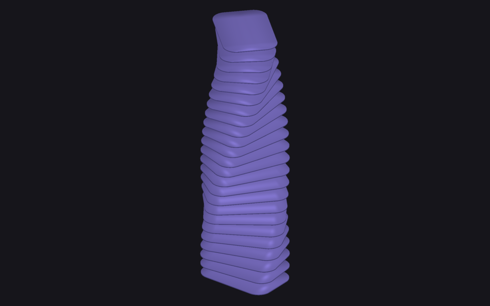
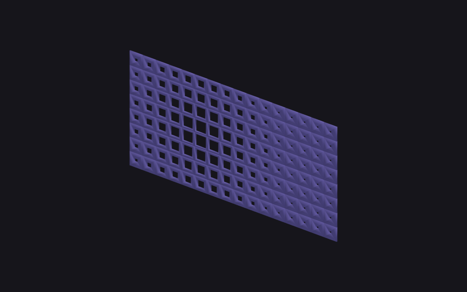
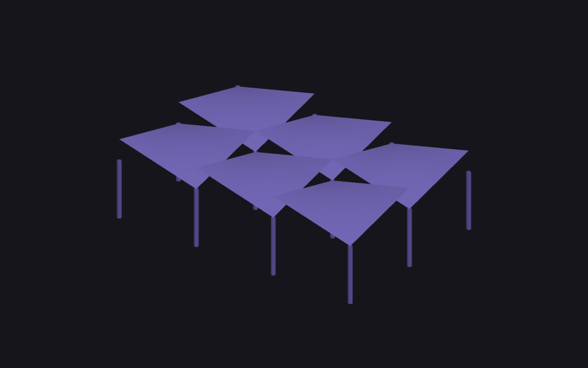
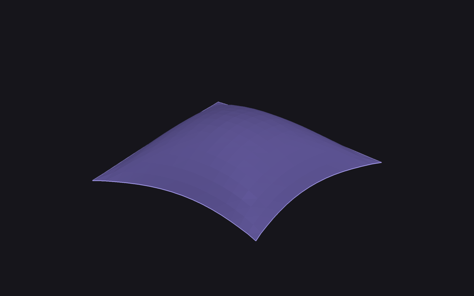
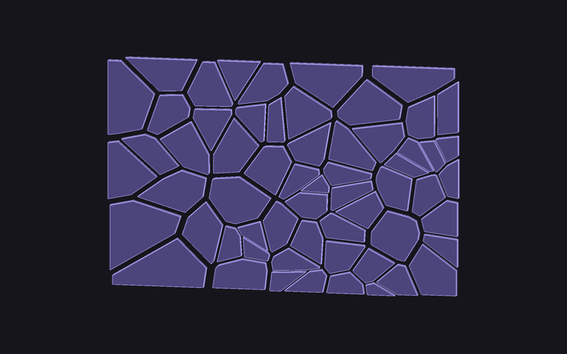
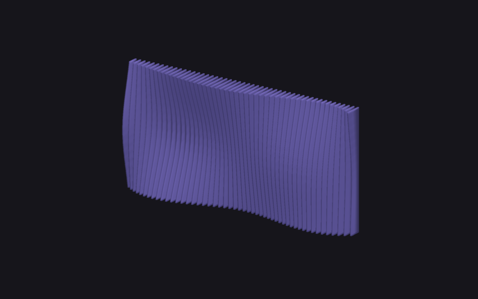
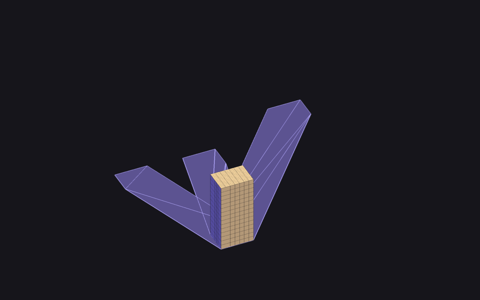
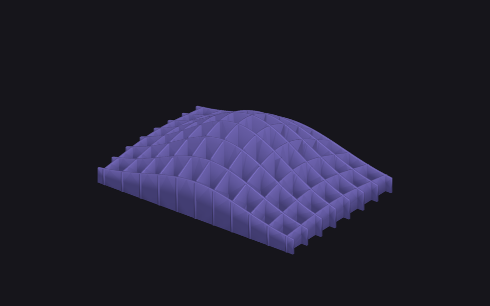

# Tensela

**Weave the design.** Parametric design an architect understands.


Tensela is a parametric design program for architects: nodes joined by cables, lists with names, and the
language of architecture (floors, bays, sun fins, sheets to cut). Tell it there are 24 floors and that each one turns
6° more than the one below, and the whole tower appears; change one number and all of it answers. It runs on Linux,
entirely on your computer.

- **Download:** [tensela.com/download](https://tensela.com/download/)
- **Manual:** [tensela.com/manual](https://tensela.com/manual/), in English and Spanish
- **Questions and ideas:** [Discussions](https://github.com/tensela/tensela/discussions); problems in
  [Issues](https://github.com/tensela/tensela/issues)

## What you can make

- **Facades and sun fins:** panels and fins that open and close by distance or by sun; skins of rectangles,
  hexagons or Voronoi cells.
- **Roofs and surfaces:** surfaces through curves or points, hyperbolic paraboloids, ribs, grids and diagrids.
- **Structures:** hanging cables and membranes that find their own shape, space frames, a first check of the bars
  (not a structural calculation).
- **Sun and shadow:** the sun for any place and date, shadows, sun hours on a facade, daylight inside.
- **Fabrication:** sections and waffles, pieces laid flat on sheets with their numbers, a check before 3D printing.
- **Your workflow:** OBJ, STL, 3MF, DXF, SVG and PDF for your CAD, BIM, renderer, laser cutter or 3D printer.

Each of these recipes is a project that comes with Tensela, explained step by step in the manual:

<table>
<tr>
<td width="25%" align="center" valign="top"><a href="https://tensela.com/manual/recipes/twisting-tower/"></a><br><sub>A tower that turns</sub></td>
<td width="25%" align="center" valign="top"><a href="https://tensela.com/manual/recipes/breathing-facade/"></a><br><sub>A facade that breathes</sub></td>
<td width="25%" align="center" valign="top"><a href="https://tensela.com/manual/recipes/hypar-roof/"></a><br><sub>A roof of hyperbolic paraboloids</sub></td>
<td width="25%" align="center" valign="top"><a href="https://tensela.com/manual/recipes/hanging-vault/"></a><br><sub>A vault that finds its own shape</sub></td>
</tr>
<tr>
<td width="25%" align="center" valign="top"><a href="https://tensela.com/manual/recipes/voronoi-skin/"></a><br><sub>A Voronoi skin</sub></td>
<td width="25%" align="center" valign="top"><a href="https://tensela.com/manual/recipes/rib-wall/"></a><br><sub>A rib wall</sub></td>
<td width="25%" align="center" valign="top"><a href="https://tensela.com/manual/recipes/sun-study/"></a><br><sub>A sun study</sub></td>
<td width="25%" align="center" valign="top"><a href="https://tensela.com/manual/recipes/waffle-model/"></a><br><sub>A waffle model ready to cut</sub></td>
</tr>
</table>

## What is in this repository

- `src/tensela/`: the program.
- `tests/`: its tests, with their own data in `tests/data/`.
- `tools/`: small tools for working on it.
- `manual/`: the manual, in English (`en/`) with a Spanish translation (`es/`). The website shows it; anyone can fix
  or translate it here.
- `examples/`: example projects (`.tela` files).

## Run it from the code

Tensela needs Python 3.11 or newer.

```
python3 -m venv .venv
.venv/bin/pip install -e ".[ui]"
.venv/bin/tensela-app                 # the window
.venv/bin/tensela project.tela --obj project.obj   # without a window: compute and export
```

The tests: `.venv/bin/pip install pytest` and then `QT_QPA_PLATFORM=offscreen .venv/bin/pytest`. Before sharing a
change, `tools/translation_keys.py` checks that every text of the interface is translated.

## Licence

- The code of Tensela is free software: you can redistribute it and modify it under the terms of the **GNU General
  Public License, version 3 or later** (`LICENSE`).
- The manual is under **Creative Commons Attribution-ShareAlike 4.0** (`manual/LICENSE`).
- The examples are in the public domain under **CC0 1.0** (`examples/LICENSE`): use them freely in your own work.
- **What you design with Tensela is yours.** The licence of the program does not apply to your projects.
- The name “Tensela” and its logo are not covered by these licences: see `TRADEMARKS.md`.
- Tensela comes **without warranty**, as the GPL says. Its structural, environmental and fabrication results are
  approximations for design: have a professional check what carries responsibility. In plain words:
  [tensela.com/legal](https://tensela.com/legal/).

To contribute, see `CONTRIBUTING.md`. To report a security problem, see `SECURITY.md`. Anything else:
contact@tensela.com.
